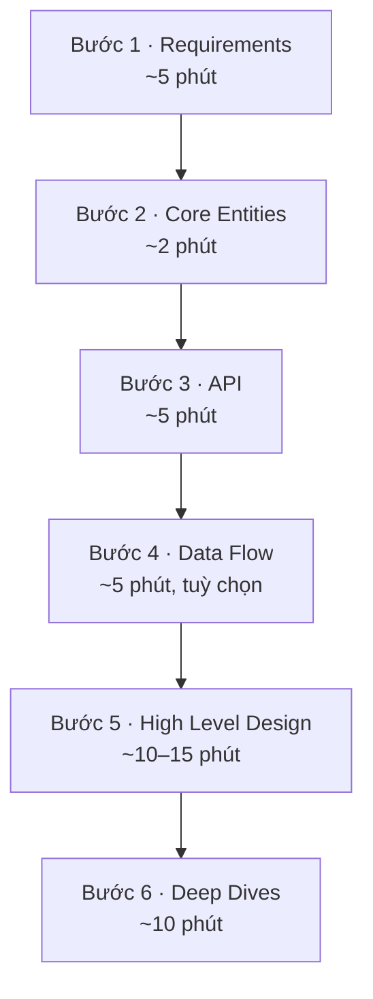
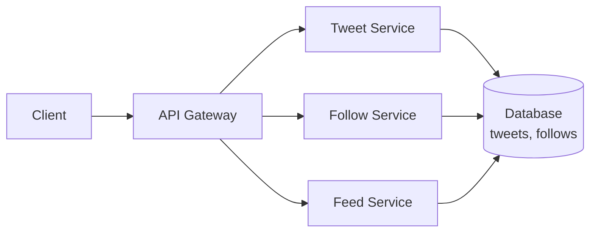

Thử hình dung thế này. Bạn vào phòng phỏng vấn, người phỏng vấn đưa bút và nói: "Thiết kế giúp tôi một hệ thống giống Twitter." Bạn biết cache là gì, biết database sharding, biết cả message queue. Bạn bắt đầu vẽ: một cái load balancer, vài server, rồi nghĩ nên cache feed ở đâu, rồi tranh luận với chính mình nên dùng Kafka hay RabbitMQ. Bốn mươi lăm phút trôi qua. Bảng trắng kín chữ, nhưng nếu ai hỏi "user đăng một tweet thì dữ liệu đi đâu?", bạn không trả lời trọn được.

Kịch bản đó có tên trong khoá học tôi đang theo: **không giao được một hệ thống chạy được** (fail to deliver a working system). Đây là lý do phổ biến nhất khiến ứng viên mid-level trượt vòng system design. Điều đáng chú ý là người trượt thường *không thiếu kiến thức*. Họ thiếu một trình tự: làm gì trước, làm gì sau, mỗi việc tốn bao lâu.

Bài này là ghi chép của tôi về cái trình tự đó. Khoá học gọi nó là **Delivery Framework**.

> *System design interview* là vòng phỏng vấn mà bạn nhận một bài toán mơ hồ ("thiết kế Uber", "thiết kế rate limiter") và phải chia nó thành các mảnh hạ tầng: server, database, cache… Không có một đáp án đúng duy nhất. Người phỏng vấn xem cách bạn gỡ bài toán, cân nhắc đánh đổi, và trình bày suy nghĩ. Vòng này hiếm khi xuất hiện ở vị trí mới vào nghề, nhưng từ mid-level trở lên thì gần như chắc chắn có.

## Sáu bước, theo đúng thứ tự

Nếu bạn còn nhớ hồi đi học phải lập dàn ý trước khi viết văn, thì framework này chính là dàn ý cho một buổi system design. Lý do cũng y như vậy: có dàn ý thì không lạc đề, và lỡ bí giữa chừng thì biết mình đang ở đâu để đi tiếp.



Mỗi bước dùng kết quả của bước trước. Requirements cho biết hệ thống phải làm gì. Từ đó rút ra các thực thể. Thực thể là thứ API trao đổi. API quyết định cần những hộp nào trong bản vẽ. Còn bản vẽ là thứ bạn đem ra mổ xẻ ở phần cuối. Nhảy cóc là mất cái nền đó.

Dưới đây là từng bước. Tôi dùng lại ví dụ Twitter của khoá học, vì ai cũng biết Twitter làm gì.

## 1. Requirements: hỏi trước khi vẽ (~5 phút)

Đề bài lúc nào cũng mơ hồ một cách cố ý. Việc đầu tiên là biến nó thành một danh sách cụ thể, bằng cách **hỏi**, như đang ngồi với khách hàng hay product manager. Requirements chia làm hai loại.

Lấy một quán phở làm ví dụ. "Quán bán phở bò, phở gà, có quẩy" là chuyện quán *làm được gì*. "Bưng ra trong 5 phút, mở cửa 24/7, nước dùng tô nào cũng như tô nào" là chuyện quán *làm tốt đến mức nào*. Hai loại requirements tương ứng đúng với hai câu đó.

### Functional requirements: hệ thống làm được gì

Đây là các câu dạng "User có thể…". Với Twitter:

- User có thể đăng tweet.
- User có thể follow user khác.
- User có thể xem tweet của những người mình follow.

Chỉ ba dòng là đủ, và đó là cố ý. Twitter thật có hàng trăm tính năng, nhưng phần còn lại của buổi phỏng vấn chỉ xoay quanh việc thiết kế cho đúng những gì bạn liệt kê ở đây. Liệt kê mười cái là tự trói tay mình. Khoá học nói thẳng: chọn ra **top 3** là một phần của bài thi.

### Non-functional requirements: hệ thống phải tốt đến đâu

Đây là các câu dạng "Hệ thống phải…". Với Twitter:

- Hệ thống phải sẵn sàng cao (*highly available*), ưu tiên điều này hơn tính nhất quán.
- Hệ thống phải mở rộng được tới hơn 100 triệu DAU (*daily active users*, số người dùng hoạt động mỗi ngày).
- Độ trễ (*latency*, thời gian từ lúc gửi request đến lúc nhận kết quả) phải thấp: feed hiện ra dưới 200ms.

Để ý là có **con số**. "Hệ thống phải nhanh" là câu vô nghĩa, vì hệ thống nào chẳng phải nhanh. "Feed hiện ra dưới 200ms" thì vừa nói *phần nào* cần nhanh, vừa cho một mục tiêu để thiết kế hướng tới.

Nghĩ ra non-functional requirements khó hơn nhiều, nhất là với domain mình chưa quen. Đây là checklist tôi chép vào sổ. Đi qua từng dòng, rồi giữ lại 3–5 cái quan trọng nhất cho bài toán đang làm:

| Hạng mục | Câu cần tự hỏi |
|---|---|
| **CAP theorem** | Consistency hay availability quan trọng hơn? |
| **Environment constraints** | Có ràng buộc gì về môi trường chạy không? Chạy trên điện thoại pin yếu, máy ít RAM, mạng 3G? |
| **Scalability** | Có kiểu tải đặc biệt nào không: dồn vào giờ cao điểm, tăng vọt dịp lễ? Đọc nhiều hơn hay ghi nhiều hơn? |
| **Latency** | Request nào cần trả về nhanh, và nhanh đến mức nào? |
| **Durability** | Mất dữ liệu thì nghiêm trọng đến đâu? Mạng xã hội mất vài like thì không sao, ngân hàng mất một giao dịch thì có chuyện. |
| **Security** | Cần bảo vệ dữ liệu và phân quyền chặt đến mức nào? |
| **Fault tolerance** | Một phần hệ thống chết thì phần còn lại phải chịu được đến đâu? |
| **Compliance** | Có luật hay quy định nào phải tuân theo không? |

Dòng đầu tiên cần giải thích thêm một chút. *CAP theorem* nói rằng khi một hệ thống phân tán bị đứt mạng giữa các phần (*partition*), bạn chỉ giữ được một trong hai thứ. Một là *consistency*: ai đọc cũng thấy dữ liệu mới nhất. Hai là *availability*: ai hỏi cũng được trả lời, dù câu trả lời có thể hơi cũ. Ví dụ, số dư tài khoản ngân hàng cần consistency, vì hiển thị sai số tiền là chuyện lớn. Còn số like của một tweet thì cần availability: chậm vài giây cũng chẳng ai để ý, miễn là app không báo lỗi. Partition thì không tránh được trong hệ thống phân tán, nên câu hỏi thực tế chỉ còn là chọn bên nào.

### Còn Capacity Estimation thì sao?

Nhiều tài liệu khuyên tính nhẩm ngay từ đầu: bao nhiêu user, bao nhiêu request mỗi giây, cần bao nhiêu ổ đĩa. Khoá học thì khuyên ngược lại: **chỉ tính khi con số làm thay đổi thiết kế**. Ứng viên tính một hồi rồi kết luận "à, nhiều lắm" thì người phỏng vấn chẳng thu được gì ngoài việc biết bạn làm được phép nhân.

Khi nào thì đáng tính? Chẳng hạn khi thiết kế hệ thống tìm top chủ đề đang hot. Số lượng chủ đề quyết định chuyện lớn: dữ liệu vừa trong một máy, hay phải chia ra nhiều máy. Lúc đó con số là thứ quyết định thiết kế, nên mới cần tính. Cách an toàn là nói thẳng với người phỏng vấn: "Tôi xin phép tính khi cần, trong lúc thiết kế."

## 2. Core Entities: những danh từ của bài toán (~2 phút)

Bước này rất nhanh: liệt kê các **thực thể cốt lõi**, tức là những "thứ" mà hệ thống lưu trữ và API trao đổi qua lại. Với Twitter:

- User
- Tweet
- Follow

Để tìm ra chúng, có hai câu hỏi giúp được. *Ai* là người tham gia vào hệ thống? Và functional requirements cần những *danh từ* nào? Đọc lại ba requirements ở trên, ba danh từ hiện ra ngay.

Vì sao chưa vẽ luôn cả data model với đủ bảng và cột? Vì lúc này bạn chưa biết mình còn thiếu gì. Trong lúc thiết kế, kiểu gì cũng sẽ lòi ra thực thể mới hoặc quan hệ mới. Danh sách ngắn thì dễ sửa. Các cột cụ thể sẽ được thêm dần ở bước 5, khi đã rõ request nào thay đổi dữ liệu nào.

Một chi tiết nhỏ mà tôi thích: khoá học nhắc nên đặt tên thực thể cho tử tế. Có người phỏng vấn để ý cả chuyện đó, vì đặt tên vẫn luôn là một trong những việc khó nhất của nghề này.

## 3. API: hợp đồng giữa hệ thống và người dùng (~5 phút)

Trước khi vẽ kiến trúc, hãy định nghĩa **API**: hệ thống nhận vào gì và trả ra gì. Thường thì mỗi functional requirement sẽ ứng với một hoặc vài endpoint. Có một quyết định nhanh cần đưa ra ở đây: dùng giao thức nào.

Quay lại quán phở. REST giống gọi món theo thực đơn có sẵn: "cho một phở bò", quán mang ra đúng tô phở bò tiêu chuẩn. GraphQL giống dặn kỹ: "phở bò, không hành, thêm quẩy, ít bánh". Bạn nhận đúng thứ mình muốn, không thừa không thiếu. RPC giống đầu bếp gọi thẳng vào bếp sau: nhanh, gọn, nhưng chỉ người trong quán mới dùng.

- **REST**: dùng các HTTP verb (GET, POST, PUT, DELETE) để thao tác trên *resource*. Đây là lựa chọn mặc định.
- **GraphQL**: client tự khai báo cần đúng những field nào. Hợp khi có nhiều loại client với nhu cầu dữ liệu khác nhau.
- **RPC** (ví dụ gRPC): gọi hàm từ xa, nhanh hơn REST. Hợp cho các service nội bộ gọi nhau khi hiệu năng là ưu tiên.

Lời khuyên của khoá học rất gọn: **đừng nghĩ nhiều, mặc định chọn REST**, trừ khi có lý do cụ thể. Với Twitter, dùng các entity làm resource, và tên resource để ở số nhiều:

```text
POST /v1/tweets          body: { "text": string }
GET  /v1/tweets/{id}     -> Tweet
POST /v1/follows         body: { "followee_id": string }
GET  /v1/feed            -> Tweet[]
```

Có một điều đáng để ý: không endpoint nào nhận `user_id` của người đang gọi. User hiện tại được lấy từ token xác thực trong header của request, **không bao giờ** từ body hay URL. Nếu tin vào `user_id` do client gửi lên thì ai cũng có thể đăng tweet dưới tên người khác.

## 4. Data Flow: chỉ khi cần (~5 phút)

Bước này là **tuỳ chọn**. Nó dành cho những hệ thống xử lý dữ liệu qua nhiều công đoạn, như pipeline hay crawler. Lúc đó, mô tả trình tự xử lý trước sẽ giúp bước vẽ kiến trúc dễ hơn. Ví dụ, với một web crawler:

1. Lấy danh sách URL ban đầu
2. Tải và phân tích HTML
3. Trích các URL mới từ trang
4. Lưu dữ liệu
5. Lặp lại

Twitter không có chuỗi xử lý dài như vậy, nên bỏ qua.

## 5. High Level Design: vẽ hộp và mũi tên (~10–15 phút)

Giờ mới đến phần mà nhiều người muốn nhảy vào ngay từ đầu: vẽ kiến trúc. Các thành phần là những khối cơ bản như server, database, cache, nối với nhau bằng mũi tên.

Mẹo quan trọng nhất ở bước này: **đi lần lượt từng endpoint**. Lấy `POST /v1/tweets` ra, hỏi "request này đi qua đâu, ghi vào đâu", rồi vẽ đủ để nó chạy. Xong thì sang endpoint tiếp theo. Bản vẽ lớn dần, và cuối cùng chắc chắn đáp ứng được mọi requirement, vì nó được dựng lên từ chính các requirement đó.

Với Twitter, sau khi đi hết bốn endpoint, bản vẽ đơn giản có thể trông như thế này:



API Gateway là cửa vào duy nhất, nhận mọi request rồi chuyển tới đúng service. Feed Service phải làm hai việc: tìm danh sách người mà user đang follow, rồi lấy tweet mới nhất của từng người.

Vài điều nên nhớ khi vẽ:

- **Vừa vẽ vừa nói.** Giải thích dữ liệu đi qua những đâu, và mỗi request làm thay đổi gì (trong database, cache, queue).
- **Ghi cột ngay cạnh database**, nhưng chỉ những cột liên quan đến thiết kế. Bảng User có tên, email, mật khẩu thì ai cũng biết, không cần viết ra.
- **Thấy chỗ cần tối ưu thì ghi chú lại rồi đi tiếp.** Cám dỗ lớn nhất ở bước này là thêm cache, thêm queue quá sớm, để rồi hết giờ mà hệ thống vẫn chưa chạy hết các requirement. Phức tạp hoá để dành cho bước sau.

## 6. Deep Dives: gia cố bản thiết kế (~10 phút)

Bản vẽ ở trên *chạy được*, nhưng chắc chắn sẽ chậm khi lấy feed. Không sao cả. Đó chính là việc của bước cuối. Khoảng 10 phút còn lại dùng để:

- kiểm tra thiết kế đã đáp ứng các non-functional requirements chưa,
- xử lý các trường hợp biên,
- tìm và gỡ các điểm nghẽn (*bottleneck*),
- trả lời những câu hỏi đào sâu của người phỏng vấn.

Non-functional requirements từ bước 1 giờ được dùng làm bản đồ. Cần chịu được hơn 100 triệu DAU? Hãy nói về scale ngang, cache, sharding database (scale ngang là thêm máy thay vì nâng cấp một máy; sharding là chia dữ liệu ra nhiều database, mỗi cái giữ một phần). Cần feed dưới 200ms? Đây mới là bài toán thú vị nhất của Twitter: **fanout-on-read hay fanout-on-write**.

Hai cách này khác nhau ở chỗ *khi nào* thì gom feed. Fanout-on-read nghĩa là mỗi lần bạn mở app, hệ thống mới đi gom tweet của tất cả những người bạn follow. Cách này giống như mỗi sáng tự ra từng sạp báo mua từng tờ. Fanout-on-write nghĩa là khi ai đó đăng tweet, hệ thống chép sẵn tweet đó vào feed của từng follower. Cách này giống như báo được giao tận nhà từ sáng sớm, bạn chỉ việc mở cửa ra lấy. Cách thứ hai đọc rất nhanh, nhưng một người nổi tiếng có 100 triệu follower đăng một tweet là hệ thống phải ghi 100 triệu lần. Chọn bên nào, hoặc kết hợp cả hai thế nào, chính là phần mà người phỏng vấn muốn nghe bạn lý luận.

Mức độ chủ động ở bước này phụ thuộc vào level. Ứng viên junior có thể để người phỏng vấn chỉ ra chỗ cần cải thiện. Ứng viên senior được kỳ vọng tự tìm ra và dẫn dắt cuộc thảo luận. Nhưng chủ động không có nghĩa là nói lấn át: hãy chừa chỗ cho người phỏng vấn hỏi, vì họ thường có sẵn những tín hiệu cụ thể muốn nghe từ bạn.

## Điều tôi rút ra

Đọc xong, cái đọng lại với tôi không nằm ở bước nào cụ thể, mà ở **thứ tự** của chúng. Sáu bước này ép mình làm cho hệ thống *chạy được* trước, rồi mới làm cho nó *tốt*. Đó cũng là điều tôi hay quên khi code ngoài đời.

Phiên bản bỏ túi để mang vào phòng phỏng vấn:

1. **Requirements**: 3 functional, 3–5 non-functional có con số. Chỉ tính toán khi con số đổi được thiết kế.
2. **Core Entities**: liệt kê danh từ, chưa cần cột.
3. **API**: mặc định REST, user lấy từ token.
4. **Data Flow**: chỉ khi hệ thống là một pipeline.
5. **High Level Design**: đi từng endpoint, chưa tối ưu.
6. **Deep Dives**: lấy non-functional requirements làm bản đồ.

Bài này là ghi chép của tôi khi học [Delivery Framework](https://www.hellointerview.com/learn/courses/system-design/lesson/orientation/delivery) trong khoá system design của Hello Interview. Ví dụ Twitter, thời lượng từng bước và checklist đều lấy từ đó. Các phần sau của series sẽ đi vào những khái niệm nền mà bước 5 và 6 cần tới.
